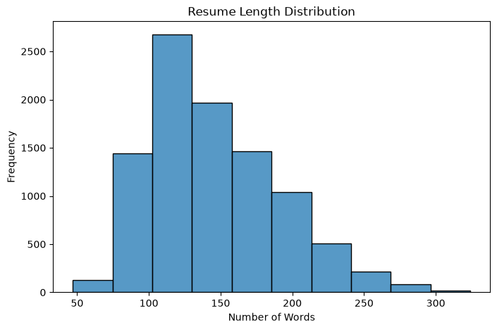
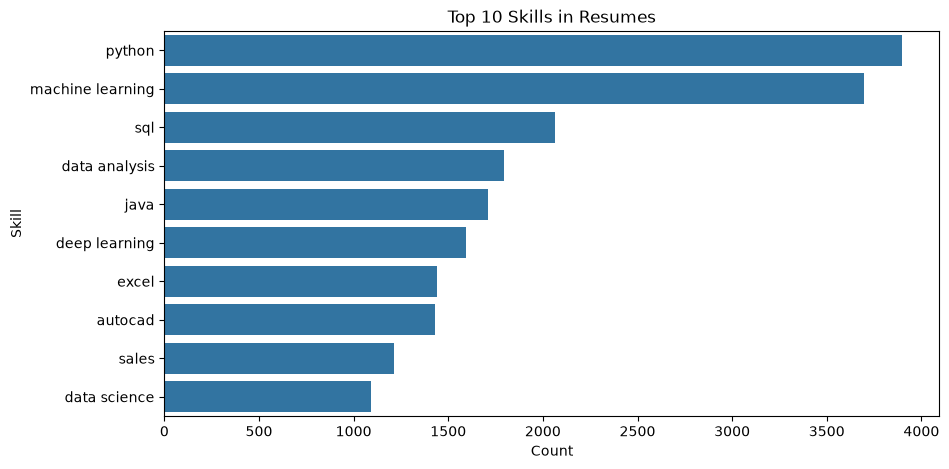
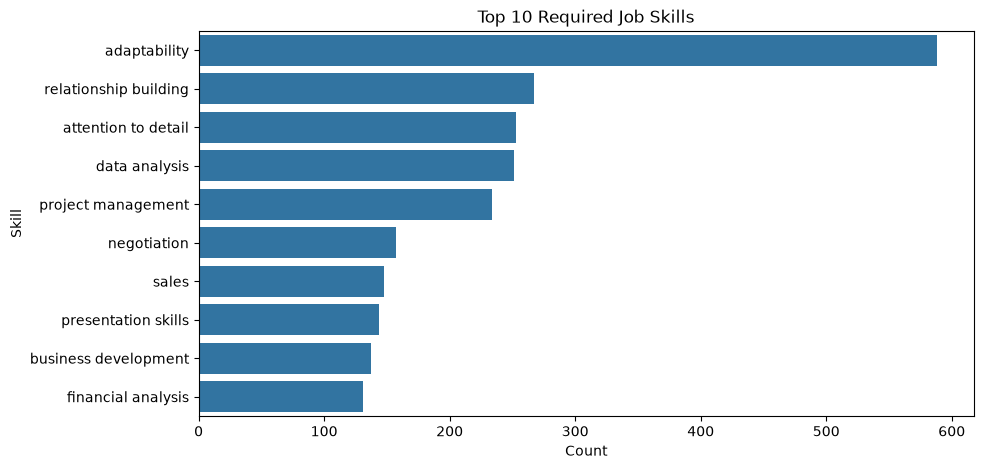
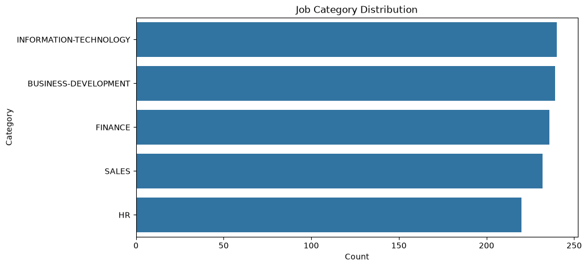
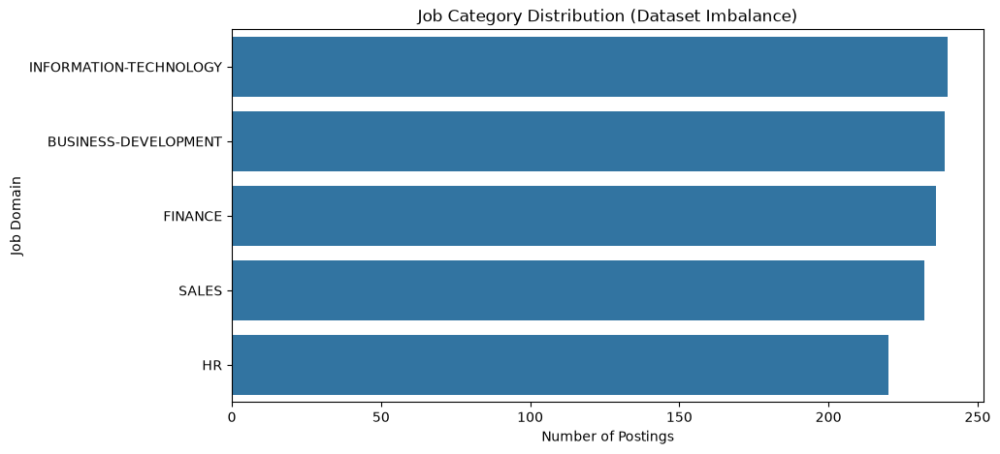

# Milestone 1 — Exploratory Data Analysis Report

**Project:** AI-Based Resume Skill Gap Analyzer  
**Milestone:** Data Collection, Preprocessing, and Exploration  
**Team:** DEPI — AI & Data Science Track

## 1. Introduction and Scope

We explored the resume, job-description, and matching datasets to understand their structure, check their quality, prepare text for NLP, and identify patterns in resume lengths and required skills. This report documents the work in `notebooks/01_data_preprocessing_and_eda.ipynb`, including the preprocessing functions imported from `src/preprocessing.py`.

The analysis uses all records rather than a reduced sample. It covers data loading, schema inspection, missing values, duplicates, section extraction, text cleaning, tokenization, stopword removal, lemmatization, processed-data exports, skill frequencies, job categories, domain-specific requirements, and match coverage and scores. The charts below are the original saved notebook figures.

## 2. Dataset Overview

**Source:** [Job-Resume Matching Dataset on Hugging Face](https://huggingface.co/datasets/nonameee12233/job-resume-matching)

| Dataset | Local input file | Records | Columns | Purpose |
|---|---|---:|---:|---|
| Resumes | `data/raw/cv.csv` | 9,544 | 11 | Candidate text and supplied skills for resume analysis |
| Job descriptions | `data/raw/job.csv` | 1,167 | 10 | Job text, categories, and supplied required skills |
| Matches | `data/raw/matches.csv` | 122,560 | 13 | Candidate–job relationships and supplied scores |

The local job file is named `job.csv`. Files under `data/sample/` are not used by this notebook. Calls such as `.head()` and printing the first record only preview the data; they do not reduce the records used in preprocessing or analysis.

### 2.1 Fields and Types

The notebook uses `.info()` to inspect column names, types, and non-null counts. Text and serialized lists or embeddings are stored as strings; numeric columns use integer or floating-point types.

| Dataset | String fields | Integer fields | Floating-point fields |
|---|---|---|---|
| Resumes | `candidate_id`, `target_position`, `resume_text`, `clean_skills`, `clean_skills_json`, `education_text`, `experience_text`, `inferred_category`, `embedding` | `source_row` | `years_experience` |
| Jobs | `job_title`, `category`, `job_description`, `job_text`, `clean_skills`, `clean_skills_json`, `education_text`, `embedding` | `job_id` | `years_required` |
| Matches | `candidate_id`, `label_strength` | `job_id`, `candidate_rank` | `final_score`, `raw_score`, `semantic_score`, `skill_score`, `position_score`, `category_score`, `experience_score`, `education_score`, `candidate_rank_pct` |

All fields are non-null in the loaded data. The embeddings and component scores already exist in the source data; this milestone does not train embeddings or validate the meaning of those scores.

### 2.2 Initial Text Inspection

We printed a resume and a job description to inspect their structure. The resume preview contains a target position, objective, skills, education, and experience. The job preview contains an application link, title, organization description, responsibilities, and requirements. This inspection helped identify URLs, capitalization differences, punctuation, and joined words requiring attention.

## 3. Data Quality Checks

We applied `isnull().sum()` to every column and `duplicated().sum()` to each complete table.

| Check | Resumes | Jobs | Matches |
|---|---:|---:|---:|
| Missing cells across all columns | 0 | 0 | 0 |
| Exact duplicate rows | 0 | 0 | 0 |
| Loaded records | 9,544 | 1,167 | 122,560 |

The notebook calls `drop_duplicates().reset_index(drop=True)` on resumes and jobs. Because no duplicate rows were found, their sizes remain unchanged. It also fills null resume and job text with empty strings as a defensive step; no values need replacement in the current data. Matches are inspected but are not passed through the resume/job cleaning pipeline.

These checks establish basic completeness and exact-row uniqueness. They do not establish that labels are correct, rule out near-duplicate text under different identifiers, or detect every placeholder or formatting problem.

## 4. Preprocessing Workflow

### 4.1 Environment and Document Loading

The notebook imports pandas for data handling, Matplotlib and Seaborn for plots, `ast` for reading serialized skill lists, `Counter` for frequencies, and NLTK for NLP. It resolves project paths so it can run from the project root or the `notebooks` directory and imports reusable functions from `src/preprocessing.py`.

The document loader supports PDF, DOCX, and TXT: it extracts text from PDF pages, reads DOCX paragraphs, and reads TXT files as UTF-8. However, the dataset analysis itself loads CSV text. Availability of these loaders is not evidence that parsing accuracy was tested across document formats.

### 4.2 Resume Section Extraction

`extract_resume_sections()` uses case-insensitive regular expressions to capture content associated with **Experience**, **Education**, and **Skills**. Matches extend until another recognized heading or the end of the text. The extracted dictionary is stored in `structured_sections` for each resume. Missing sections remain empty strings.

This creates a basic structured representation. The final processed resume is still generated from the full `resume_text`, rather than only these extracted sections.

### 4.3 Text Cleaning

`clean_text()` is applied to `resume_text` and `job_description` to create `processed_resume` and `processed_job`. It:

1. Converts text to lowercase.
2. Removes URLs matching `http\S+|www\S+`.
3. Replaces characters outside letters, digits, whitespace, `+`, `#`, and `.` with spaces.
4. Collapses repeated whitespace and trims surrounding spaces.

The notebook prints the first 500 characters before and after cleaning to inspect the changes. For example, the uppercase application link in the job preview is removed after lowercasing and URL cleaning.

### 4.4 NLP Processing

The notebook configures `SSL_CERT_FILE` using `certifi` and requests the NLTK resources `stopwords`, `wordnet`, and `omw-1.4`. It then prepares:

- `RegexpTokenizer(r'[A-Za-z][A-Za-z0-9+#]*')` to create tokens beginning with a letter.
- The English NLTK stopword set to remove common words.
- `WordNetLemmatizer` to reduce words to their default WordNet lemma forms.

`preprocess_nlp()` tokenizes cleaned text, removes stopwords, and lemmatizes the remaining tokens. The notebook previews the first 50 tokens of a resume and job. It joins the tokens with spaces to create `final_processed_resume` and `final_processed_job`, then previews the first 500 characters of each.

For example, the resume preview changes “all kinds of data” to tokens including “kind” and “data”, while the skill name “c++” is retained. Lemmatization uses the default part of speech; it is not contextual grammatical analysis.

### 4.5 Saved Outputs

| Output | Rows | Columns | Added fields |
|---|---:|---:|---|
| `data/processed/final_cleaned_cv.csv` | 9,544 | 15 | `structured_sections`, `processed_resume`, `tokens`, `final_processed_resume` |
| `data/processed/final_cleaned_jobs.csv` | 1,167 | 13 | `processed_job`, `tokens`, `final_processed_job` |

These exports are used by Notebook 02. Saving occurs **before** the EDA fields `resume_length` and `skills_list` are added, so those fields are not part of these CSV exports. Running the notebook replaces the processed files.

Additional checks performed when preparing this report confirmed that both exports preserve the raw identifier order and coverage, and that neither has empty final processed text. These are supplementary checks, separate from the notebook's printed results.

## 5. Resume Length Analysis

The notebook calculates:

```python
cv["resume_length"] = cv["final_processed_resume"].apply(
    lambda x: len(x.split())
)
```

This measures **processed word counts**, not original document word counts or page lengths. The first five displayed lengths are 116, 161, 109, 183, and 238 words.



*Figure 1. Histogram of all 9,544 processed resume lengths, using 10 bins as in the notebook.*

The following descriptive statistics supplement the notebook histogram and were calculated from the full processed resume export:

| Statistic | Processed words |
|---|---:|
| Minimum | 47 |
| 25th percentile | 111 |
| Median | 137 |
| Mean | 145.58 |
| 75th percentile | 174 |
| Maximum | 324 |
| Standard deviation | 44.89 |

The middle half of resumes contains 111–174 processed words. The mean is higher than the median, consistent with the longer upper tail visible in the histogram. Resume-length variation should be considered when interpreting similarity scores; this analysis does not establish a truncation threshold or remove long resumes.

## 6. Skill Frequency Analysis

### 6.1 Counting Method

The notebook converts each `clean_skills` string to a Python list using `ast.literal_eval`, stores the result as `skills_list`, combines all lists within each dataset, and uses `Counter(...).most_common(10)` to find the most frequent labels.

These are **occurrences in supplied skill lists**, not free-text word frequencies and not skills predicted by the project model. A supplementary report check found no repeated exact skill strings within individual lists in the current data. Synonyms and spelling variants are not merged by this counting method.

### 6.2 Top 10 Resume Skills

| Rank | Skill | Count |
|---|---|---|
| 1 | python | 3,900 |
| 2 | machine learning | 3,696 |
| 3 | sql | 2,063 |
| 4 | data analysis | 1,792 |
| 5 | java | 1,710 |
| 6 | deep learning | 1,596 |
| 7 | excel | 1,438 |
| 8 | autocad | 1,432 |
| 9 | sales | 1,212 |
| 10 | data science | 1,092 |



*Figure 2. Most frequent supplied skill labels across all resumes.*

Python and machine learning lead the resume labels, followed by SQL and data analysis. The top ten emphasize programming and data-related skills, but also include AutoCAD and sales, showing that the resume corpus is not limited to one technical specialization.

### 6.3 Top 10 Required Job Skills

| Rank | Skill | Count |
|---|---|---|
| 1 | adaptability | 588 |
| 2 | relationship building | 267 |
| 3 | attention to detail | 253 |
| 4 | data analysis | 251 |
| 5 | project management | 234 |
| 6 | negotiation | 157 |
| 7 | sales | 148 |
| 8 | presentation skills | 144 |
| 9 | business development | 137 |
| 10 | financial analysis | 131 |



*Figure 3. Most frequent supplied required-skill labels across all jobs.*

Adaptability leads job requirements, followed by relationship building and attention to detail. Data analysis and sales appear in both top-ten lists. The differing rankings show why the skill dictionary needs both technical and interpersonal vocabulary. Because the datasets differ in size and composition, comparing their raw frequencies does not establish a labor-market shortage or an individual candidate's missing skills.

## 7. Job Categories and Dataset Imbalance

The notebook uses `jobs["category"].value_counts()` to count postings in each category and divides by 1,167 to calculate their percentages.

| Category | Jobs | Percentage |
|---|---|---|
| INFORMATION-TECHNOLOGY | 240 | 20.57% |
| BUSINESS-DEVELOPMENT | 239 | 20.48% |
| FINANCE | 236 | 20.22% |
| SALES | 232 | 19.88% |
| HR | 220 | 18.85% |



*Figure 4. Number of postings in each job category.*

The largest category contains 240 postings and the smallest contains 220, a ratio of approximately 1.09. The five job categories are therefore nearly balanced by record count. This does not establish balanced resume categories, equal label quality, demographic balance, or representativeness of the wider job market.

The notebook plots the same category counts again when explicitly examining dataset imbalance:



*Figure 5. The notebook's second category plot, using the same data and ordering as Figure 4. It is an additional presentation of the imbalance check, not a different distribution.*

## 8. Top Required Skills per Job Domain

The notebook groups jobs by `category`, combines the `skills_list` values within each group, and applies `Counter(...).most_common(5)`. The complete results are recorded below. Counts refer to occurrences within that domain, not across all jobs.

### BUSINESS-DEVELOPMENT

| Skill | Count |
|---|---|
| adaptability | 134 |
| business development | 111 |
| relationship building | 104 |
| sales | 70 |
| negotiation | 65 |

### FINANCE

| Skill | Count |
|---|---|
| financial analysis | 108 |
| adaptability | 105 |
| financial reporting | 91 |
| data analysis | 70 |
| budgeting | 69 |

### HR

| Skill | Count |
|---|---|
| adaptability | 102 |
| employee relations | 102 |
| attention to detail | 81 |
| performance management | 79 |
| data analysis | 76 |

### INFORMATION-TECHNOLOGY

| Skill | Count |
|---|---|
| adaptability | 112 |
| project management | 84 |
| attention to detail | 51 |
| troubleshooting | 46 |
| technical support | 30 |

### SALES

| Skill | Count |
|---|---|
| adaptability | 135 |
| sales | 77 |
| relationship building | 68 |
| customer relationship management | 44 |
| product knowledge | 44 |

Adaptability is among the top skills in every domain. Finance emphasizes financial analysis and reporting; HR emphasizes employee relations and performance management; Sales and Business Development include relationship building and sales. Information Technology includes project management, troubleshooting, and technical support. These results support domain-specific analysis rather than assuming one universal list of important skills.

## 9. Match Coverage and Supplied Score Distribution

### 9.1 Coverage and Reference Integrity

The notebook counts distinct candidate and job identifiers in `matches` and checks whether each reference exists in the corresponding raw table.

| Measure | Result |
|---|---:|
| Match records | 122,560 |
| Candidates with matches | 9,532 of 9,544 (99.87%) |
| Jobs with matches | 1,164 of 1,167 (99.74%) |
| Candidates without matches | 12 |
| Jobs without matches | 3 |
| Match rows referencing unknown candidates | 0 |
| Match rows referencing unknown jobs | 0 |

Coverage is high but not complete. The match table represents selected relationships, not every possible candidate–job pair. An absent match record should not automatically be interpreted as a negative match. A supplementary report check also found zero duplicate `(candidate_id, job_id)` pairs.

### 9.2 Supplied Final Scores

The notebook calls `matches["final_score"].describe()` and reports:

| Statistic | Value |
|---|---|
| Count | 122,560 |
| Mean | 0.585740 |
| Standard deviation | 0.036012 |
| Minimum | 0.430009 |
| 25th percentile | 0.564059 |
| Median | 0.586842 |
| 75th percentile | 0.607529 |
| Maximum | 0.756099 |

Scores are concentrated around a mean of approximately 0.586, with the middle half between 0.564059 and 0.607529. These are **supplied dataset scores**, not evaluation results produced by the project model. They must not be described as accuracy, precision, recall, or F1. The EDA does not validate their calibration or select a matching threshold.

## 10. Parsing Challenges and Analysis Limitations

1. **Document layouts:** The notebook notes that complex PDFs with two-column layouts or nested tables can disrupt reading order and mix experience and education dates. This is a stated parsing limitation, not a measured error rate in the CSV analysis.
2. **Section headings:** Regex extraction depends on recognizable Experience, Education, and Skills headings. Alternative headings or missing sections may reduce extraction quality. The patterns also search within prose rather than requiring standalone heading lines.
3. **Joined words:** The displayed job tokens include `descriptionjob`, `financereports`, and `detroitflsa`. Cleaning does not restore these missing word boundaries.
4. **Skill punctuation:** Cleaning preserves periods, but the tokenizer excludes them. Names such as `.NET` and `Node.js` can change form, while `C++` and `C#` are supported by the token pattern.
5. **Language and normalization:** The pipeline uses English stopwords and WordNet. It does not implement multilingual preprocessing, contextual disambiguation, or synonym merging in this milestone.
6. **Label validity:** No missing values and no exact duplicates do not establish the correctness of supplied skills, inferred categories, or match scores. Manual annotation quality and near-duplicate text are not assessed by the notebook.
7. **Scope of evaluation:** This milestone explores and prepares data. It does not report skill-extraction accuracy, PDF/DOCX parsing accuracy, or the predictive performance of the matching system.

## 11. Conclusions and Implications for the Next Milestone

We loaded and inspected all three datasets, confirmed basic completeness and exact-row uniqueness, processed the full resume and job text, and saved model-ready exports. The EDA visualized resume lengths, the top ten resume and job skills, and job categories; it also identified the top five required skills per domain and checked match coverage and supplied scores.

The findings support the following next steps:

- Develop a skill dictionary covering technical, functional, and interpersonal skills across the five job domains.
- Review synonyms, punctuation-sensitive skill names, joined words, section boundaries, and the quality of supplied labels.
- Test document parsing on actual PDF, DOCX, and TXT examples with different layouts and headings.
- Evaluate skill extraction and resume–job matching separately, with domain-level results and a split strategy that controls candidate or job overlap.
- Account for candidates and jobs without match records when designing evaluation.

These are recommendations arising from the EDA, rather than work claimed as completed in Milestone 1.

## 12. Reproducibility and Notebook Coverage

Run `notebooks/01_data_preprocessing_and_eda.ipynb` from top to bottom with the full raw CSVs available. NLTK setup may download resources, and the export step overwrites the two processed CSVs. The notebook uses all rows for preprocessing and aggregate results.

| Notebook activity | Report location |
|---|---|
| Imports, project paths, document-loader note | Section 4.1 |
| Raw loading, dimensions, text previews, schema inspection | Section 2 and Appendix A |
| Missing values, duplicate checks, duplicate removal, text fill | Section 3 |
| Section extraction, certificate setup, NLTK resources | Sections 4.2 and 4.4 |
| Cleaning, token previews, and final text previews | Sections 4.3–4.4 and Appendix A |
| Processed CSV export | Section 4.5 |
| Resume-length calculation, preview, and histogram | Section 5 |
| Skill-list conversion, top-ten counts, and charts | Section 6 |
| Category counts, percentages, and both category plots | Section 7 |
| Top five required skills per domain | Section 8 |
| Final findings, match coverage, and score summary | Sections 9–11 |

**Sources:** the local notebook, `src/preprocessing.py`, the three raw CSVs, and the two processed CSVs. The attached project proposal defines the Milestone 1 scope. Resume-length descriptive statistics and the explicitly marked supplementary checks were calculated during report preparation; they are not presented as additional original notebook outputs.

## Appendix A — Recorded Preprocessing Previews

The expandable excerpts below preserve the notebook's before/after and token previews so the preprocessing steps can be inspected directly. These examples illustrate transformations; aggregate results above use the entire dataset.

<details>
<summary>Original and cleaned text previews</summary>

```text
ORIGINAL RESUME:
Target position: Senior Software Engineer Objective: Big data analytics working and database warehouse manager with robust experience in handling all kinds of data. I have also used multiple cloud infrastructure services and am well acquainted with them. Currently in search of role that offers more of development. Skills: big data, hadoop, hive, python, mapreduce, spark, java, machine learning, cloud, hdfs, yarn, core java, data science, c++, data structures, dbms, rdbms, informatica, talend, am

CLEANED RESUME:
target position senior software engineer objective big data analytics working and database warehouse manager with robust experience in handling all kinds of data. i have also used multiple cloud infrastructure services and am well acquainted with them. currently in search of role that offers more of development. skills big data hadoop hive python mapreduce spark java machine learning cloud hdfs yarn core java data science c++ data structures dbms rdbms informatica talend amazon redshift microsof

ORIGINAL JOB:
APPLY HERE
HTTPS://WWW.INDEED.COM/JOB/DIRECTOR-FINANCE-9C0196508A30CB63
JOB DESCRIPTIONJOB TITLE: DIRECTOR OF FINANCEREPORTS TO: CEO, SVDP-DETROITFLSA STATUS: EXEMPT
SUMMARYTHE SOCIETY OF ST. VINCENT DE PAUL DETROIT EXISTS TO BUILD A MORE EQUITABLE AND COMPASSIONATE WORLD THROUGH MEANINGFUL PERSONAL RELATIONSHIPS, PROVIDING WHATEVER IS NEEDED TO HELP OUR NEIGHBORS GET BACK ON THEIR FEET AND ON A PATH TOWARDS SELF-SUSTAINABILITY. OUR PROGRAMS PROVIDE SUPPORT RANGING FROM UTILITY, HOUSING, AND FOO

CLEANED JOB:
apply here job descriptionjob title director of financereports to ceo svdp detroitflsa status exempt summarythe society of st. vincent de paul detroit exists to build a more equitable and compassionate world through meaningful personal relationships providing whatever is needed to help our neighbors get back on their feet and on a path towards self sustainability. our programs provide support ranging from utility housing and food assistance to education and mentorship. we also operate a network
```

</details>

<details>
<summary>First 50 processed tokens</summary>

```text
Resume Tokens:
['target', 'position', 'senior', 'software', 'engineer', 'objective', 'big', 'data', 'analytics', 'working', 'database', 'warehouse', 'manager', 'robust', 'experience', 'handling', 'kind', 'data', 'also', 'used', 'multiple', 'cloud', 'infrastructure', 'service', 'well', 'acquainted', 'currently', 'search', 'role', 'offer', 'development', 'skill', 'big', 'data', 'hadoop', 'hive', 'python', 'mapreduce', 'spark', 'java', 'machine', 'learning', 'cloud', 'hdfs', 'yarn', 'core', 'java', 'data', 'science', 'c++']

Job Tokens:
['apply', 'job', 'descriptionjob', 'title', 'director', 'financereports', 'ceo', 'svdp', 'detroitflsa', 'status', 'exempt', 'summarythe', 'society', 'st', 'vincent', 'de', 'paul', 'detroit', 'exists', 'build', 'equitable', 'compassionate', 'world', 'meaningful', 'personal', 'relationship', 'providing', 'whatever', 'needed', 'help', 'neighbor', 'get', 'back', 'foot', 'path', 'towards', 'self', 'sustainability', 'program', 'provide', 'support', 'ranging', 'utility', 'housing', 'food', 'assistance', 'education', 'mentorship', 'also', 'operate']
```

</details>

<details>
<summary>Final processed text previews</summary>

```text
FINAL RESUME TEXT:
target position senior software engineer objective big data analytics working database warehouse manager robust experience handling kind data also used multiple cloud infrastructure service well acquainted currently search role offer development skill big data hadoop hive python mapreduce spark java machine learning cloud hdfs yarn core java data science c++ data structure dbms rdbms informatica talend amazon redshift microsoft azure education b tech electronics amity school engineering technolo

FINAL JOB TEXT:
apply job descriptionjob title director financereports ceo svdp detroitflsa status exempt summarythe society st vincent de paul detroit exists build equitable compassionate world meaningful personal relationship providing whatever needed help neighbor get back foot path towards self sustainability program provide support ranging utility housing food assistance education mentorship also operate network thrift store two camp nutritional center passionate driving systemic change helping neighbor me
```

</details>

<details>
<summary>First five resume lengths</summary>

```text
target_position  resume_length
0                           Senior Software Engineer            116
1                     Machine Learning (ML) Engineer            161
2  Executive/ Senior Executive- Trade Marketing, ...            109
3                     Business Development Executive            183
4                                Senior iOS Engineer            238
```

</details>

<details>
<summary>First five resume skill lists</summary>

```text
target_position  \
0                           Senior Software Engineer   
1                     Machine Learning (ML) Engineer   
2  Executive/ Senior Executive- Trade Marketing, ...   
3                     Business Development Executive   
4                                Senior iOS Engineer   

                                         skills_list  
0  [big data, hadoop, hive, python, mapreduce, sp...  
1  [data analysis, data analytics, business analy...  
2  [software development, machine learning, deep ...  
3  [accounts payables, accounts receivables, acco...  
4  [analytical reasoning, compliance testing know...
```

</details>

<details>
<summary>First five job skill lists</summary>

```text
job_title  \
0                  Director of Finance   
1              Human Resources Manager   
2                          Salesperson   
3         Business Development Manager   
4  AOC Human Resources Project Manager   

                                         skills_list  
0  [financial management, accounting, gaap princi...  
1  [recruiting, talent management, compliance, em...  
2  [sales, customer relationship management, tech...  
3  [account management, client relationship manag...  
4  [project management, human resources administr...
```

</details>

